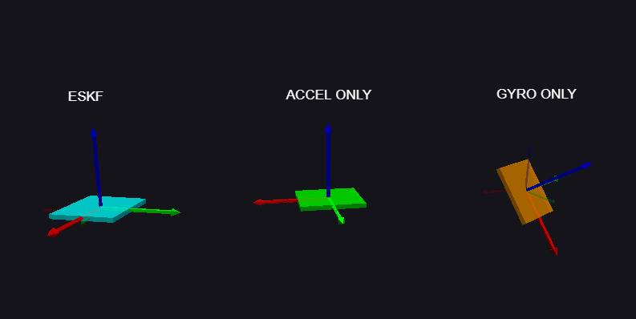

# Real-Time IMU Orientation Estimation Using ESKF

### ESP32 + MPU6050 + Python

## Overview

This project compares three methods for estimating 3D orientation using an MPU6050 IMU:

1. **Gyroscope only:** Integrates angular velocity to estimate orientation.
2. **Accelerometer only:** Estimates roll and pitch using gravity.
3. **Error-State Kalman Filter (ESKF):** Combines both sensors to improve orientation estimation.

An ESP32 reads the sensor measurements and sends them to Python through USB. VPython displays the three estimates simultaneously.

## Experimental Visualization



| Method | Advantage | Limitation |
|---|---|---|
| Gyroscope | Smooth, responsive | Accumulates drift |
| Accelerometer | Provides tilt reference | Sensitive to movement |
| ESKF | Combines both measurements | Requires calibration and tuning |

**Observation:** After fast movements, the gyroscope estimate can drift. The ESKF uses accelerometer measurements to correct roll and pitch, although some residual errors remain.

## Hardware

- ESP32 development board
- MPU6050 (GY-521)
- Jumper wires
- USB cable


### Wiring

| MPU6050 | ESP32 |
|---|---|
| VCC | 3V3 |
| GND | GND |
| SDA | GPIO 21 |
| SCL | GPIO 22 |

## How It Works

**1. Gyroscope prediction**

The gyroscope measures angular velocity. We integrate it using rotation matrices to predict the new orientation.

**2. Accelerometer correction**

When linear acceleration is small, the accelerometer provides the direction of gravity.

We compare measured gravity with predicted gravity to calculate an orientation error.

**3. ESKF**

The filter maintains:

- Estimated rotation matrix
- Estimated gyroscope bias
- Error covariance matrix

The ESKF predicts orientation using the gyroscope, then corrects it using the accelerometer and Kalman gain.

## Sensor Calibration

Before starting, the sensor remains stationary while Python collects approximately 1,000 measurements.

Calibration estimates:

- Initial gyroscope bias
- Gyroscope noise covariance
- Accelerometer noise covariance

These values are calculated from sensor measurements instead of being chosen arbitrarily.

The current implementation assumes constant gyro bias between updates.

## Running the Project

Install dependencies:

```bash
py -m pip install -r requirements.txt
```

Upload `firmware/mpu6050_stream.ino` to the ESP32.

Then run:

```bash
py python/compare_imu.py
```

The program reads MPU6050 data over USB and displays three virtual IMU models.

## Limitations

- Yaw drift cannot be corrected without an additional heading reference.
- Rapid linear acceleration can disturb accelerometer corrections.
- Gyroscope bias can change over time.
- Fast rotations may introduce measurement errors.
- ESKF performance depends on covariance estimation and calibration.

## Future Improvements

- Adaptive accelerometer measurement noise
- Better gyroscope bias estimation
- Improved initial covariance estimation
- Quantitative comparison of estimation errors

## Conclusion

This project demonstrates how gyroscope integration and accelerometer measurements can be combined using an Error-State Kalman Filter to improve real-time 3D orientation estimation.

It provides a practical comparison between individual sensors and sensor fusion.
